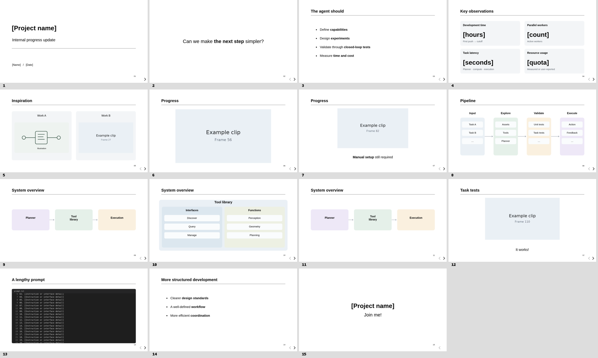

# Minimal HTML Slides

A reusable HTML presentation template and Codex skill for concise internal reports.

White backgrounds, black text, rounded diagrams, staged reveals, and smooth transitions. Built on reveal.js; slides work offline as a standalone HTML file.



## Preview

Open [`assets/template/template.html`](assets/template/template.html) in a browser after cloning or downloading this repository.

## Create a deck

Requires Python 3; no extra Python packages are needed.

```bash
python3 scripts/new_deck.py /path/to/my-deck
cd /path/to/my-deck
# Edit deck.json and replace the sample media.
python3 build.py deck.json --output slides.html
```

The generated `slides.html` embeds its styles, scripts, and media. Share that file directly.

## Controls

- Click blank space, press Space, or use arrow keys to advance reveals and slides.
- Press **Esc** for the slide overview; use the mouse wheel to browse and click a thumbnail to jump.
- Click an image or video to enlarge it; close with **Esc**, the × button, or the backdrop.
- Shared videos preserve playback position across slides.

## Included layouts

Cover, centered question, click-revealed bullets and cards, comparison, video, pipeline, architecture overview, expanded detail, shrink-and-caption, scrolling code, and closing slide.

## Use as a Codex skill

This repository is also a skill: see [SKILL.md](SKILL.md). Place the folder in your Codex skills directory, or ask Codex to read that file when preparing a presentation.

## Documentation

- [Authoring guide](references/authoring.md)
- [Animation conventions](references/motion.md)
- Optional browser verification: `scripts/check_deck.cjs` (requires Playwright).

Bundled reveal.js retains its MIT license in [`assets/template/vendor/LICENSE`](assets/template/vendor/LICENSE).
